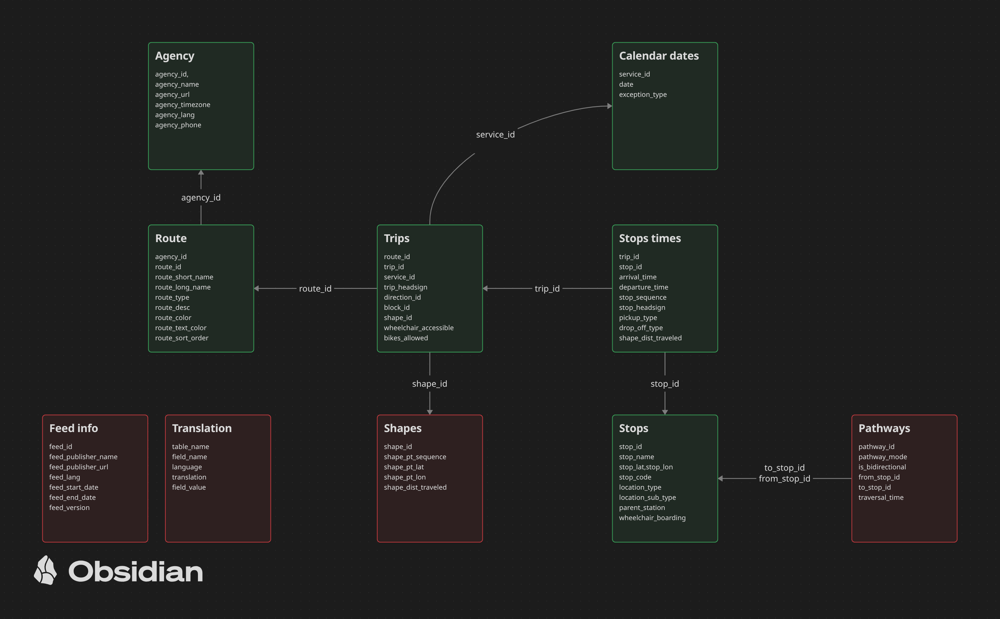

# GtfsFilter – GTFS feed szűrése route_type alapján

> **AI-használat:** a projekt AI (Claude) segítségével készült.
>
> **Saját munka:**
> - az alapötlet és az eredeti 6 lépéses terv (route_type szerinti szűrés,
>   id-k kigyűjtése, fájlonkénti segédfüggvények, zipelés),
> - a fájlok közötti kapcsolatok diagramja (`Kapcsolatok.png`),
> - a projekt felépítése (`Main`, `GtfsFilter`, `Test` osztályok).
>
> **AI-val készült:**
> - a README kibővítése és Markdown-formázása (szűrési sorrend, szabályok,
>   buktatók: CSV-idézőjelek, streaming, BOM, parent_station),
> - az XML-program által használt fájlok összefoglalója,
> - a `GtfsFilter.java` függvényfejlécei és Javadoc-kommentjei,
> - a `GtfsFilter.java` és a `Main.java` megvalósítása (a fenti terv alapján).

Cél: a budapesti GTFS feedből csak a megadott járműtípus(ok) sorait megtartani
(pl. metró = 1), és az eredményt zipként kiírni. A szűrt zipet egy meglévő
XML-generáló program (omm-file formátum) dolgozza fel.

## Használat

A `budapest_gtfs` mappából (ahol a GTFS txt-k vannak):

```
javac -d out gtfsFilter/*.java
java -cp out gtfsFilter.Main <forrás_mappa> <cél_zip> <route_type> [route_type ...]
java -cp out gtfsFilter.Main . Budapest.zip 1
```

Metróra (1) kb. 3 mp alatt lefut; az eredmény 6 fájl (agency, routes, trips,
stop_times, stops, calendar_dates), 4 vonal (M1–M4), 151 megálló.

### XML generálása (OpenMetroMaps)

```
gtfs-import --input <útvonal>/Budapest.zip --output example-data/budapest.xml --ignore-missing-calendar
```

- `--ignore-missing-calendar` kell, mert a feedben nincs `calendar.txt`.
- A „Kőbánya-Kispest [D]” szülőállomás-név miatt a `RunGtfsImport.java`
  `NameChanger` utótagjai közé bekerült a `" [D]"` is (a szűrő a mezőkhöz
  nem nyúl, a nevek tisztítása az import dolga).

route_type értékek ebben a feedben:

| kód | típus    |
|-----|----------|
| 0   | villamos |
| 1   | metró    |
| 3   | busz     |
| 4   | hajó     |
| 11  | troli    |
| 109 | HÉV      |

A route_type lehet alapkód (0–12) vagy bővített kód (pl. metró: 400–404,
109 = elővárosi vasút) – feedtől függ, ezért mindig a `routes.txt` alapján nézzük.

## Mit használ az XML-program

| fájl                          | mire                                                            |
|-------------------------------|-----------------------------------------------------------------|
| `agency.txt`                  | csak konzolra írja ki                                           |
| `routes.txt`                  | `route_short_name` → vonal neve, `route_color` → színe          |
| `stops.txt`                   | `stop_name`, `stop_lat`, `stop_lon` → állomások (név szerint összevonva) |
| `trips.txt` + `stop_times.txt`| `stop_sequence` → megállósor                                    |
| `calendar.txt`                | beolvassa, de nem használja; ha hiányzik és `ignoreMissingCalendar = false`, leáll |

Nem használja: shapes, pathways, feed_info, translations, calendar_dates.
Ezeket nem kell szűrni (a mi feedünkben nincsenek is, kivéve a calendar_dates-t).

## Szűrési sorrend (kaszkád)



*(zöld = megvan a feedben, piros = nincs)*

| # | fájl                 | feltétel                                          | gyűjtött id-k         |
|---|----------------------|---------------------------------------------------|-----------------------|
| 1 | `routes.txt`         | `route_type` ∈ kiválasztott                       | routeIds, agencyIds   |
| 2 | `agency.txt`         | `agency_id` ∈ agencyIds                           |                       |
| 3 | `trips.txt`          | `route_id` ∈ routeIds                             | tripIds, serviceIds   |
| 4 | `stop_times.txt`     | `trip_id` ∈ tripIds                               | stopIds               |
| 5 | `stops.txt`          | `stop_id` ∈ stopIds + szülőállomásaik (`parent_station`) |                |
| 6 | `calendar_dates.txt` | (opcionális) `service_id` ∈ serviceIds            |                       |

Minden lépés az előző lépésben összegyűjtött id-kre szűr, ezért a sorrend kötött.
Ha egy opcionális fájl nem létezik, kihagyjuk (nem hiba).

## Lépések a kódban

1. Argumentumok feldolgozása: forrás mappa, cél zip, szűrendő route_type(-ok).
2. Fájlonként: fejléc beolvasása, a szükséges oszlopok indexének megkeresése
   név alapján (ne fix pozícióval, a sorrend feedenként eltérhet).
3. Soronként olvasunk; ha a sor megfelel a szűrésnek:
   - változatlanul kiírjuk a kimenetbe,
   - kigyűjtjük belőle a következő fájlhoz kellő id-ket (`HashSet<String>`).
4. Fájlonként egy segédfüggvény, a fenti sorrendben hívva
   (`filterRoutes`, `filterAgency`, `filterTrips`, `filterStopTimes`,
   `filterStops`, `filterCalendarDates`).
5. A kimeneti txt-ket bezipeljük (`java.util.zip.ZipOutputStream`).

## Szabályok / figyelni kell

- **Csak sorokat szűrünk, oszlopot nem:** a fejléc és minden oszlop változatlan.
  A kiválasztott sort az eredeti szövegével írjuk ki (nem rakjuk össze újra),
  így az idézőjelek is megmaradnak.
- **stop_times.txt ~400 MB:** csak streamelve (`BufferedReader`), soronként
  szabad feldolgozni, nem szabad egészben memóriába tölteni.
- **CSV:** idézőjeles mezőben lehet vessző (pl. `"Pasaréti tér / Rákospalota, ..."`),
  ezért nem elég a `split(",")`, idézőjel-kezelő parser kell.
- **Kódolás:** UTF-8 (ékezetes megállónevek); figyelni az esetleges BOM-ra
  az első fejlécmezőben.
- **stops.txt:** a megtartott megállók `parent_station`-jét is meg kell tartani,
  különben érvénytelen lesz a feed. Mivel a szülő sora a gyerek *előtt* is
  lehet, a stops.txt-n két kör kell (1. kör: parent_station-ök gyűjtése,
  2. kör: kiírás) – a fájl kicsi, akár memóriába is olvasható.
- **calendar.txt hiányzik:** a feedben csak `calendar_dates.txt` van, ezért az
  XML-programot `ignoreMissingCalendar = true` beállítással kell futtatni.
- **Fájlnevek:** a zipben kisbetűsek legyenek (`calendar_dates.txt`), mert ott
  számít a kis- és nagybetű.
